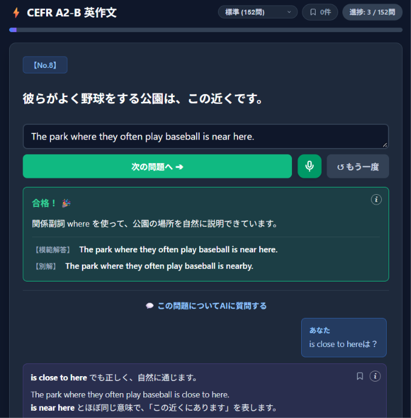

# CEFR A2-B English Composition

An interactive Japanese-to-English composition trainer designed for mastering practical English grammar and phrasing at the CEFR A2–B levels. Powered by the **OpenAI Responses API**, it provides flexible semantic grading, spoiler-free hints for retries, natural alternative phrasings, voice input via the Web Speech API, and multi-turn AI coaching.

> **Note:** The application UI, source prompts, and coaching explanations are written in Japanese for Japanese speakers learning English.



---

## Key Features

- **Curated Grammar Datasets (369 Prompts Total)**
  - **基礎 / Basic**: 150 foundational prompts organized by grammatical structure.
  - **標準 / Standard**: 152 core prompts covering intermediate clause structures, participles, relatives, and subjunctive mood.
  - **標準・追加 / Standard Extra**: 67 supplementary prompts for extended practice.
- **Category-Clustered Scheduling**
  - Automatically groups 3–4 uncompleted prompts from the same grammatical category in a row to reinforce structural patterns before switching to a new random category.
- **Flexible, Spoiler-Free AI Evaluation**
  - Uses OpenAI Structured Outputs (`json_schema`) to classify answers into `pass`, `close`, or `fail`.
  - Accepts natural, idiomatic, and conversational English equivalents beyond rigid textbook answers.
  - **Strict Spoiler Prevention**: When an answer is `close` or `fail`, both the system prompt and backend enforce hiding the model answer and full translations—providing concise grammatical hints so learners can self-correct.
  - Displays the reference answer, a natural CEFR A2–B2 alternative expression (when applicable), and one-point feedback upon passing, with instant **Repeat (`↺ もう一度`)** support.
- **Stateful Multi-Turn AI Coach Q&A & Bookmarks**
  - Ask follow-up questions about nuances, word choices, or custom sentences directly within each prompt.
  - Maintains multi-turn conversation and reasoning context via OpenAI's `previous_response_id` and automatic context compaction, rendered cleanly in Markdown.
  - Bookmark helpful Q&A exchanges to review anytime or jump directly back to the associated question.
- **English Voice Input**
  - Built-in microphone support (`en-US`) powered by the browser's Web Speech API for speaking-based composition practice, plus a standalone `SpeechPractice` React component with Longest Common Subsequence (LCS) word-matching utilities.
- **Zero-Signup Local Persistence**
  - Tracks per-dataset completion progress and saved Q&A bookmarks in `localStorage`, complete with a filterable progress modal (`All` / `Uncompleted` / `Completed`) and direct question jumping.

---

## Tech Stack

- **Frontend**: TypeScript, Vite, React 19, Marked, Web Speech API, CSS3
- **Backend**: PHP (`cURL` proxy to `https://api.openai.com/v1/responses`)
- **AI Integration**: OpenAI Responses API (Structured Outputs & Stateful Multi-Turn Responses)

---

## Project Structure

```text
cefr-a2b/
├── index.html                     # Application entry HTML
├── prompt/
│   ├── system.md                  # System prompt for composition evaluation
│   └── system-ask.md              # System prompt for multi-turn AI Q&A
├── public/
│   ├── api.php                    # PHP backend endpoint for OpenAI Responses API
│   └── config.openai.php          # PHP backend configuration (reads OPENAI_API_KEY)
├── scripts/
│   └── dev-php.js                 # Dev launcher for PHP's built-in web server
├── src/
│   ├── main.tsx                   # Core state management, UI logic, and API client
│   ├── style.css                  # Application stylesheet
│   ├── types.ts                   # TypeScript type definitions
│   ├── components/
│   │   └── SpeechPractice.tsx     # React speech practice & LCS scoring component
│   ├── data/
│   │   ├── phrases-u2.ts          # Basic dataset (150 items)
│   │   ├── phrases-u3.ts          # Standard dataset (152 items)
│   │   └── phrases-u3-extra.ts    # Standard Extra dataset (67 items)
│   └── utils/
│       └── speechRecognition.ts   # Web Speech API wrapper & LCS comparison logic
├── package.json
├── tsconfig.json
└── vite.config.ts
```

---

## Prerequisites

- **Node.js** (v20+ recommended) & **npm**
- **PHP** (7.4+ or 8.x+ with `curl` and `mbstring` extensions enabled)
- An **OpenAI API key**

---

## Getting Started (Local Development)

### 1. Install dependencies

```bash
npm install
```

### 2. Set your OpenAI API key

Set the `OPENAI_API_KEY` environment variable in your OS or shell before starting the dev server (`public/config.openai.php` reads it automatically; model and reasoning settings can also be adjusted there):

```bash
# macOS / Linux
export OPENAI_API_KEY="sk-proj-your-api-key"

# Windows (PowerShell)
$env:OPENAI_API_KEY="sk-proj-your-api-key"
```

### 3. Start the development servers

```bash
npm run dev
```

This single command concurrently launches:
- **Vite dev server** on `http://localhost:5173` (automatically opens your default external browser so Web Speech API microphone permissions work properly).
- **PHP built-in server** on `http://localhost:8000` serving `public/` (proxied from Vite via `/api.php`).
  - *Note:* `scripts/dev-php.js` automatically resolves `php` from your system `PATH` or standard Windows installations (`C:\xampp\php\php.exe`, `C:\php\php.exe`).

---

## Production Build & Deployment

### 1. Build the frontend

```bash
npm run build
```

Vite compiles TypeScript and bundles static assets—alongside `public/api.php` and `public/config.openai.php`—into the `dist/` directory.

### 2. Deploy to a PHP-capable web server

1. Upload the contents of `dist/` to your web server's public directory (e.g., `public_html/`).
2. Upload the `prompt/` directory (`system.md` and `system-ask.md`) **one level above** the directory containing `api.php` (i.e., `../prompt/` relative to `api.php`):
   ```text
   /your-server-root/
   ├── prompt/
   │   ├── system.md
   │   └── system-ask.md
   └── public_html/          # Document root (contents of dist/)
       ├── index.html
       ├── api.php
       ├── config.openai.php
       └── assets/
   ```
3. Provide the `OPENAI_API_KEY` environment variable on the server (e.g., `SetEnv OPENAI_API_KEY "..."` in `.htaccess`).

---

## Available Scripts

| Command | Description |
| :--- | :--- |
| `npm run dev` | Starts Vite (`:5173`) and the PHP built-in server (`:8000`) concurrently |
| `npm run dev:vite` | Starts only the Vite frontend server |
| `npm run dev:php` | Starts only the PHP built-in server on port `8000` |
| `npm run build` | Type-checks with `tsc` and builds production assets into `dist/` |
| `npm run preview` | Previews the production frontend build locally |

---

## License

Released under the [MIT License](./LICENSE).
